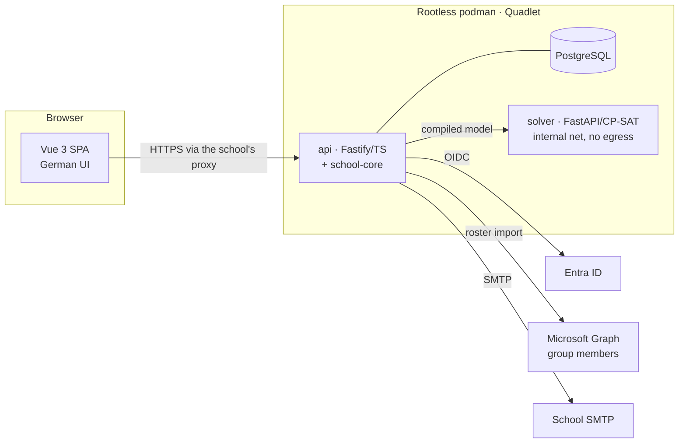

# SchulWahl — Architecture decision

Status: proposal for review · 2026-10-27 · Repo-ready. Builds on the decisions in
`open-decisions.md`.

## 1. Decisions

| Concern | Decision | Basis |
| ------- | -------- | ----- |
| Product | Open-source, self-hostable app for Austrian schools; the only environmental assumption is Entra ID with class groups | Scope correction 2026-10-27 |
| Repository | New public repo (`school-allocation`), npm workspaces, conventions of school-election | D-02 |
| Authentication | Entra OIDC, own single-tenant app registration, confidential client, state + nonce + `tid` check; no app roles needed | D-10, D-11 |
| Person key | `(tid, oid)`; no school ID number stored | D-10 |
| Roster | Entra class groups via Microsoft Graph (pre-provisions `oid`), or CSV upload (binds at first sign-in); frozen append-only batches | D-10, D-12, D-22 |
| Authorization | Kind from the roster; eligibility from the frozen batch; privileged roles managed in the app and audited; first admins from config | `identity-and-roles.md` |
| Catalogues | Project-week activities and WPF subjects maintained in the app; printable catalogue generated | 2026-10-27 |
| Project-week mechanism | Ranked choices → allocation run → review → publish; `mechanism` is a campaign property | D-01 |
| Fixed class activities | Item `mode: fixed` with target classes; pre-assigned at opening, choosable by nobody, resolved by the model compiler before the solver | D-24 |
| Fees | Shown on the item; whoever is assigned pays; no acceptance step; export per student | D-07 |
| Allocation engine | **OR-Tools CP-SAT** in a separate Python service; the TypeScript core compiles the model and re-validates the result before anything can be published | D-03 c, D-04 b |
| WPF | Multi-year plan chosen at once, validated by versioned rules in the TypeScript core; group allocation optional later on the same solver | D-09 |
| Notifications | Transactional outbox → SMTP submission; transport behind an interface | D-16, D-18 |
| Exports | xlsx for every overview | Principals work in Excel |
| Deployment | Quadlet stack (app, Postgres, solver), signed images, nightly auto-update always; own host or sub-path | D-14 |

## 2. Components

- **`packages/school-core`**: pure TypeScript, no I/O, `Date` or randomness, ESLint-fenced as in
  school-election. Eligibility, overlap, credited minutes per local date, choice completeness, model
  compilation, **independent validation of solver results**, fairness metrics, WPF rule evaluation,
  lifecycle guards. Shared by API and SPA so they never disagree.
- **`apps/api`**: Fastify 5, `pg` with raw SQL, TypeBox schemas, forward-only SQL migrations with a
  runtime-privilege allow-list, sealed-cookie session, audit chain, outbox worker, Graph and CSV
  importers, SMTP transport.
- **`apps/solver`**: Python, FastAPI, OR-Tools. Stateless. Knows nothing about schools; solves the
  compiled model (`domain-and-api.md` §6).
- **`apps/web`**: Vue 3 + Vite, including print routes for the catalogues.

## 3. Data flows

| Flow | Path | Notes |
| ---- | ---- | ----- |
| Sign-in | SPA → `/api/auth/login` → Entra → callback → person by `(tid, oid)` (or one-time e-mail bind for CSV rosters) → sealed cookie, 8 h absolute | Person and roster status re-read per request |
| Roster | Admin labels groups → "refresh" (Graph) or CSV upload → validate → diff → commit `ImportBatch` | Append-only; the campaign freezes one batch at close |
| Catalogue | Teacher proposes (choosable with eligibility, or fixed for classes) → organizer approves → publish (frozen catalogue version) → print view, xlsx | Changes after opening: organizer only, audited, affected students notified |
| Choices | Window opens → pre-assignments materialized → student sees fixed items, ranks the rest → every save persisted → completeness computed in school-core on both sides | Server time decides the window |
| Notifications | Trigger → outbox row in the same transaction (unique dedupe key) → worker → SMTP | At most one notice per key; mail-server acceptance recorded |
| Allocation | Organizer starts run → snapshot (batch, catalogue version, choices, rule version, seed) → compile → solver → validate in TS → store run → review → publish | Several runs per campaign; exactly one published |
| After publication | Manual changes, second round (D-06); same validator; audited | — |
| Attendance | KV per session for own class (project week); admin (WPF) | Separate from assignments |

## 4. Deliberate differences from school-election

| school-election | SchulWahl | Why |
| --------------- | --------- | --- |
| Anonymous ballots, random ids, no timestamps, WAL hygiene, custom Postgres image | Identified records with timestamps; stock Postgres image | Choices must be attributable; the secret-ballot apparatus has no purpose here |
| Students as anonymous key holders | Students sign in with Entra and are in the roster | Identified choices |
| Global `teacher` app role, per-election membership | Kind from the roster; privileged roles in the app; no app roles | Minimal Entra setup for any school; organizers need cross-teacher views |
| `busy` = election open | `busy` = a job executing | Windows last weeks; updates cannot wait |
| Single process | Plus the solver service | CP-SAT fits free combinations; no Node binding exists |

## 5. Alternatives considered

| Alternative | Why not (now) |
| ----------- | ------------- |
| Module inside an existing school website | Loses the OSS goal; couples releases |
| Roster from a school administration system | Every school differs; nothing is universal except Entra. Out of the product |
| `groups` claim at sign-in instead of an import | Cannot tell who has not chosen; overflows for users in many groups |
| MIP solver in Node (e.g. HiGHS via WASM) | CP-SAT handles the boolean/interval structure and lexicographic re-solves better. Worth a one-day spike in S4 if the Python service proves a burden |
| Greedy or random serial dictatorship in TypeScript | Cannot guarantee daily coverage with free combinations or express "protect the worst-off" |
| Graph `Mail.Send` for notifications | Not every school's mail is on Exchange; SMTP is universal |
| FCFS | Withdrawn for now (D-01); representable as a campaign mechanism later |
