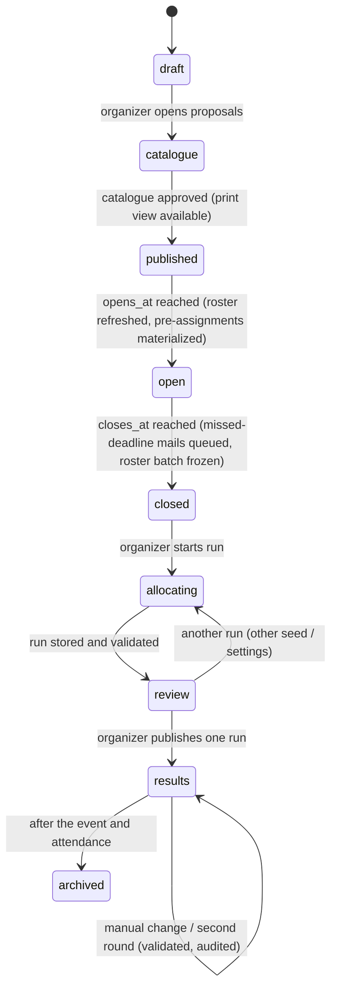

# SchulWahl — Domain and API (Phase B.7)

Status: proposal for review · 2026-10-27

## 1. Entities

| Entity | Key fields | Notes |
| ------ | ---------- | ----- |
| `Person` | `id` (uuid), `kind` (student/teacher), `display_name` | No school ID number, no birth date |
| `IdentityBinding` | `person_id`, `tid`, `oid`, `bound_at`, `method` (`graph` / `email_match` / `admin`), `import_batch_id`, `unbound_at` | Unique `(tid, oid)` while active; rebinding is audited |
| `ImportBatch` | `id`, `source` (`graph:groups` / `csv`), `fetched_at`, `payload_sha256`, `row_count`, `triggered_by`, `school_year` | Append-only |
| `RosterGroup` | `group_id` (Entra), `label`, `kind` (students / teachers), `class?`, `grade?` | Admin-maintained mapping used by the Graph import |
| `RosterEntry` | `batch_id`, `oid?`, `upn?`, `mail?`, `display_name`, `kind`, `class?`, `grade?`, `person_id?` | One per person per batch |
| `ClassTeacher` | `school_year`, `class`, `person_id`, `assigned_by` | Assigned in the app or from a CSV column |
| `SchoolYear` | `id` (e.g. `2026/27`), `starts_on`, `ends_on` | Explicit rollover |
| `Campaign` | `id`, `kind` (`project_week` / `wpf`), `mechanism` (`ranked`), `school_year`, `eligibility` (rule), `opens_at`, `closes_at`, `config` (ranks *N*, reminders, min-size policy), `status`, `roster_batch_id?` (frozen at close) | Lifecycle in §2 |
| `CatalogItem` | `id`, `campaign_id`, `title`, `description`, `teachers[]`, `mode` (`choosable` / `fixed`), `eligible` (grades/classes; choosable only), `fixed_classes[]` (fixed only), `fee_cents?`, `min`, `max`, `cancellable_below_min`, `status` (draft/proposed/approved) | Project-week activity or WPF subject. A fixed item is assigned to whole classes and cannot be ranked by anyone |
| `Session` | `item_id`, `starts_at`, `ends_at` (timestamptz), `credited` per local date (`[{date, minutes}]`), `location` | Immutable once the window opens, except by audited organizer change |
| `PreAssignment` | `campaign_id`, `item_id`, `person_id`, `source` (`class` / `manual`), `exempted_at?`, `exempted_by?`, `reason?` | Materialized from `fixed_classes` against the frozen roster when the window opens; an organizer may exempt a student, audited, who then chooses for that time |
| `WpfSubjectRule` | `item_id`, `rule_version_id`, years offered, periods per year, prerequisites, exclusions, continuation | WPF only |
| `RuleSetVersion` | `id`, `kind`, `curriculum_profile`, `effective_cohort`, `body` (declarative), `approved_by`, `approved_at` | Immutable once approved |
| `CurriculumProfile` | `id`, `sfkz[]`, `name` | SFKZ → profile mapping |
| `Choice` | `campaign_id`, `person_id`, `ranked[]` (item ids in order), `version`, `updated_at`, `entered_by` (self / organizer) | Whole-list replace; history kept in `ChoiceRevision` |
| `WpfPlan` | `campaign_id`, `person_id`, `items_by_year`, `alternatives?`, `rule_version_id`, `validation` | Multi-year plan, chosen at once |
| `AllocationRun` | `id`, `campaign_id`, `snapshot_sha256`, `seed`, `core_version`, `solver_version`, `ortools_version`, `status`, `levels[]` (value, proven), `started_by`, `published_at?` | Many per campaign, at most one published |
| `Assignment` | `run_id`, `person_id`, `item_id`, `source` (`fixed` / `solver` / `manual` / `second_round`) | Fixed rows are copied from the pre-assignments; manual rows reference a reason |
| `Attendance` | `session_id`, `person_id`, `status`, `recorded_by` | Separate from assignments |
| `OutboxMail` | `id`, `kind`, `campaign_id`, `person_id`, `dedupe_key` (unique), `state` (`queued` / `sent` / `failed`), `message_id`, `attempts`, `last_error` | Unique `dedupe_key` (e.g. `missed:<campaign>:<person>`) prevents double notices |
| `RoleGrant` | `person_id`, `role`, `scope` (school / campaign), `granted_by`, `revoked_at` | Privileged roles |
| `AuditEvent` | hash-chained per campaign, allow-listed actions with typed metadata | Pattern from school-election |

## 2. Campaign lifecycle



The guards live in school-core and are re-checked under a per-campaign advisory lock, as in
school-election's `changeElection`. Time-based transitions are evaluated by server time; a
transition that was missed during a restart is applied on start.

## 3. Choice rules (project week)

1. **Fixed items first.** When the window opens, every student of a class named in a fixed item's
   `fixed_classes` receives a `PreAssignment`. Fixed items appear in the student's plan as given;
   they cannot be ranked by anyone, and choosable items that overlap a student's fixed items are not
   offered to that student. Example: classes C and D are in Vienna from Tuesday 08:00 to Wednesday
   13:00, so their students see only Monday's items. A student whose fixed items already cover every
   day has nothing to choose and counts as complete.
2. Only **choosable** items eligible for the student's grade/class in the frozen catalogue can be
   ranked. Fixed items, ineligible items and items overlapping the student's fixed items are rejected
   server-side, so manipulated requests fail.
3. A paid item shows its fee before it can be ranked. Ranking it, or being pre-assigned to it, is
   the acceptance (D-07). There is no separate consent step.
4. **Completeness** is computed by school-core and shown live. A list is complete when:
   - the ranked items **together with the student's fixed items** contain at least one conflict-free
     combination that meets every project day's credited minimum for this grade;
   - and, in addition, min(*N*, remaining eligible items) further items are ranked (*N* per
     campaign, default 3; D-05).

   The search is exact backtracking over the student's own list, which is small.
5. Editing is allowed until `closes_at` by server time. Every save replaces the whole list
   (idempotent) and writes a revision.
6. An organizer may enter or alter a list on a student's behalf, or exempt a student from a fixed
   item (the student then chooses for that time), each with a required reason; both are audited.

**Credited minutes** are given by the teacher per session and local date (`Europe/Vienna`). They are
not derived from `end − start`, because breaks and travel do not count. A session over midnight, such
as the Vienna trip, credits each date separately.

**Overlap:** two items conflict if any of their sessions overlap. Touching end points (11:00–11:00)
do not overlap.

## 4. Notifications

| Trigger | Recipients | Required? |
| ------- | ---------- | --------- |
| Window closes | Students whose list is not complete ("did not choose on time") | **Yes** (D-16) |
| *X* days before close | Students whose list is not complete | Configurable, default on |
| Results published | All participants | Configurable |
| Second round (D-06) | Students not fully placed | If D-06 picks it |
| Activity changed after the window opened | Students who ranked it or are pre-assigned to it | Yes |

Each notice is an outbox row written in the same transaction as its trigger, with a unique
`dedupe_key`. A worker submits queued rows over authenticated SMTP (STARTTLS or implicit TLS) and
marks a row `sent` on the server's `250` reply, storing the generated `Message-ID`. Temporary
failures retry with backoff; permanent ones become `failed` with the reason. The transport is an
interface with the SMTP implementation built in, so a school can substitute its own. The state
(`sent` / `failed`) is shown on the organizer's non-submitter list; bounces are not tracked.

## 5. Allocation model (project week)

**Inputs** (frozen snapshot):

- eligible students from the roster batch;
- their pre-assignments (fixed items, minus exemptions);
- their complete or incomplete ranked lists;
- the approved catalogue with sessions and credits;
- capacities, minimums, cancellability;
- daily minimum per grade;
- the seed.

**Fixed items are resolved by the compiler, not the solver.** For each student, the credit of their
fixed items is subtracted from each day's requirement (floored at zero), and choosable items that
overlap a fixed item are dropped from that student's options. Only choosable items reach the solver.
A student with no remaining requirement gets no variables.

**Variables:**

- `x[s,o]` ∈ {0,1}, only for choosable items `o` on student `s`'s ranked list that are eligible and
  do not overlap the student's fixed items. Unranked items are never assigned.
- `y[o]` ∈ {0,1}: the item runs. Fixed to 1 unless it may be cancelled below its minimum (D-08).

**Hard constraints:**

- **Capacity:** `Σ_s x[s,o] ≤ max_o · y[o]`; minimum `Σ_s x[s,o] ≥ min_o · y[o]`.
- **No overlap:** for each student and each conflicting pair `(o1, o2)` among the student's options,
  `x[s,o1] + x[s,o2] ≤ 1`. In practice these are clique constraints per time point.
- **Indivisibility:** an item with several sessions is one variable, so it is all or nothing by
  construction.

**Soft constraint (reported, never hidden):**

- **Daily coverage:** `Σ_o credit[o,d] · x[s,o] + u[s,d] ≥ R[s,d]`, with deficit `u[s,d] ≥ 0`.

**Objective, lexicographic** (D-04 b, "protect the worst-off first"). Each level is solved, then fixed
as a bound for the next:

1. **L1:** minimize the number of students with any uncovered day.
2. **L2:** minimize the total uncovered minutes.
3. **L3:** for thresholds *t* = 4, 3, 2 (configurable), minimize the number of students whose
   minutes-weighted average rank exceeds *t*, one sub-level per threshold, the worst first. A
   student's cost is `Σ_o x[s,o] · rank(s,o) · minutes(o) / required_minutes(s)`, scaled to integers,
   where `required_minutes(s)` is the requirement left after fixed items. Students with nothing left
   to choose have no cost and are not counted in L3.
4. **L4:** minimize the total cost over all students.
5. **L5:** tie-break: minimize `Σ x[s,o] · ε(seed, s, o)`, with small deterministic pseudo-random
   weights. Equal alternatives are therefore decided by the recorded seed, not by input order.

**Reproducibility:**

- CP-SAT runs with `num_workers = 1`, `random_seed = seed`, and a **deterministic** time limit
  (`max_deterministic_time`), never a wall-clock limit.
- The OR-Tools version is pinned and stored with the run.
- Same snapshot + seed + versions → same assignment. This is tested in CI.

**Status per level:** `OPTIMAL` or `FEASIBLE` (not proven). `INFEASIBLE` or `UNKNOWN` stops the run,
and the run cannot be published. The review screen shows each level's value and whether it was proven.

**Independent validation in school-core**, before a run is stored as reviewable:

- capacity and minimum;
- overlaps;
- eligibility;
- only ranked items;
- every pre-assignment present and unchanged, and no assigned item overlapping a fixed one;
- the recomputed coverage, deficits and costs (fixed items included) must equal the solver's
  reported level values.

Any mismatch rejects the run.

**Explanation per student:** the assigned items with their ranks, minutes per day, deficits if any,
and a plain sentence on the rule ("first nobody without a full week, then as few students as possible
with mostly low-ranked choices, then the best overall result; ties by lot, seed …").

**Fairness caveat:** an optimizing allocation is not strategy-proof. A student could in theory gain by
mis-ranking, which is easier when demand is visible. Mitigation: no demand indicators (D-13), and
communicate "rank honestly — it is the best strategy for nearly everyone". The simulation (D-20)
should quantify this.

## 6. Solver contract (versioned, `contracts/allocation/v1`)

`POST /v1/solve` (internal network only):

```json
{
  "contract": "allocation/v1",
  "runId": "…",
  "seed": 123456789,
  "limits": { "deterministicTimePerLevel": 30 },
  "students": [{ "s": 17, "required": [{ "d": 0, "min": 300 }],
                 "options": [{ "o": 4, "cost": 1200, "credit": [{ "d": 0, "min": 120 }] }] }],
  "items": [{ "o": 4, "max": 20, "min": 8, "cancellable": true }],
  "conflicts": [[4, 9]],
  "levels": ["students_with_deficit", "deficit_minutes", "over:4000", "over:3000", "over:2000", "total_cost", "tiebreak"]
}
```

Response:

```json
{ "status": "OPTIMAL|FEASIBLE|INFEASIBLE|UNKNOWN|MODEL_INVALID",
  "levels": [{ "name": "…", "value": 0, "proven": true }],
  "assign": [[17, 4]], "cancelled": [9],
  "versions": { "solver": "…", "ortools": "…" } }
```

- **IDs are small integers per run.** The mapping to persons and items stays in the api.
- **No names, e-mails or classes.** The solver has no database credentials and no egress.
- **The tie-break weights are computed in the TypeScript core from the seed** and sent as part of
  `cost`. This keeps the Python side free of domain randomness.
- **Fixed items never appear in the request.** Their effect is already in `required` and in the
  pruned `options`, so the contract stays the same whether or not a campaign has fixed items.

## 7. WPF

- **Plan:** the student picks subjects for each of the three years in one go (D-09). Alternatives are
  ranked if the school wants a fallback for subjects that do not run.
- **Rules:** a declarative, versioned `RuleSetVersion` per curriculum profile and cohort, evaluated in
  school-core:
  - allowed subjects per year;
  - periods per year;
  - required total periods over the years;
  - duration and continuation (e.g. a two-year subject in consecutive years);
  - prerequisites;
  - exclusions.

  No hours are hard-coded. Every rule has positive and negative fixture cases.
- **Matura information:** computed separately from validity. It is shown as information and never
  blocks an otherwise valid plan.
- **Groups:** if subjects need group capacities, a WPF allocation model uses the same solver service
  with its own contract version. This is optional (W3).
- **Exceptions** (repeaters, late joiners, later changes): D-19.

## 8. API surface (sketch)

| Method and path | Role | Purpose |
| --------------- | ---- | ------- |
| `GET /api/auth/login`, `GET /api/auth/callback`, `POST /api/auth/logout` | — | Entra sign-in |
| `GET /api/me` | any | Person, kind, roles, binding state |
| `GET /api/campaigns` | any | Campaigns visible to me |
| `GET /api/campaigns/:id/catalogue` | any | Published catalogue (eligible items flagged for students) |
| `GET /api/campaigns/:id/my-choice` · `PUT …/my-choice` | student | Fixed items, offered items, ranked list, completeness (whole-list replace) |
| `GET /api/campaigns/:id/my-result` | student | Published assignment + explanation |
| `POST /api/items` · `PATCH /api/items/:id` | teacher (own), organizer | Propose/edit activity and sessions; `mode` choosable (with eligibility) or fixed (with target classes) |
| `POST /api/admin/campaigns` · `PATCH …/:id` · `POST …/:id/transition` | organizer | Campaign set-up and lifecycle |
| `GET/PUT /api/admin/roster/groups` | admin | Label Entra groups (students/teachers, class, grade) |
| `POST /api/admin/roster/graph/refresh` · `POST /api/admin/roster/csv` · `GET /api/admin/roster/batches/:id/diff` | admin | Roster import from Graph or CSV; diff view |
| `PUT /api/admin/classes/:class/teachers` | admin, organizer | Assign class teachers |
| `GET /api/admin/bindings/unmatched` · `POST /api/admin/bindings` | admin | Unmatched logins, audited bind/merge |
| `PUT /api/admin/campaigns/:id/choices/:personId` | organizer | On-behalf entry (reason required) |
| `POST /api/admin/campaigns/:id/preassignments/:personId/:itemId/exempt` | organizer | Exempt a student from a fixed class activity (reason required) |
| `POST /api/admin/campaigns/:id/runs` · `GET …/runs/:runId` · `POST …/runs/:runId/publish` | organizer | Allocation |
| `POST /api/admin/campaigns/:id/assignments` | organizer | Manual change (validated) |
| `GET /api/campaigns/:id/items/:itemId/participants` | teacher (own, after results), organizer, auditor | Participant list |
| `PUT /api/sessions/:id/attendance` | KV (own class), organizer; admin for WPF | Attendance |
| `GET /api/admin/campaigns/:id/export/{choices,assignments,participants,missing,attendance}.xlsx` | organizer, auditor | Exports |
| `GET /print/campaigns/:id/catalogue` | any | Printable catalogue (print CSS → PDF via browser) |
| `GET /api/admin/audit?campaign=` | admin, auditor | Audit log + export |
| `GET /api/health` | — | Includes `busy` for the update gate |

Reads are authorized per request: IDOR on reads is in scope. Status codes follow school-election: 401
for no session, 403 for the wrong role, 404 for out of scope, and 409 for a lifecycle refusal with its
code.
