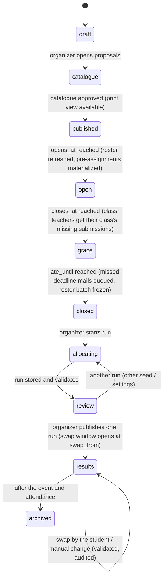

# SchulWahl — Domain and API (Phase B.7)

Status: proposal for review · 2026-10-27 · revised 2026-10-29 for the decisions of that day
(`open-decisions.md`: D-05, D-06, D-13, D-15, D-20, D-23, D-25)

## 1. Entities

| Entity | Key fields | Notes |
| ------ | ---------- | ----- |
| `Person` | `id` (uuid), `kind` (student/teacher), `display_name` | No school ID number, no birth date |
| `IdentityBinding` | `person_id`, `tid`, `oid`, `bound_at`, `method` (`graph` / `email_match` / `admin`), `import_batch_id`, `unbound_at` | Unique `(tid, oid)` while active; rebinding is audited |
| `ImportBatch` | `id`, `source` (`graph:groups` / `csv`), `fetched_at`, `payload_sha256`, `row_count`, `triggered_by`, `school_year` | Append-only |
| `RosterGroup` | `group_id` (Entra), `label`, `kind` (students / teachers), `class?`, `grade?` | Admin-maintained mapping used by the Graph import; groups are found with a searchable picker over the tenant's groups (D-23), not by typing IDs |
| `PeriodGrid` | per school: `period` (1…), `starts`, `ends` (local times) | The school's lesson periods (D-25), with a default (1. EH 7:35–8:25, 2. EH 8:30–9:20, …). Settings, not campaign data |
| `RosterEntry` | `batch_id`, `oid?`, `upn?`, `mail?`, `display_name`, `kind`, `class?`, `grade?`, `person_id?` | One per person per batch |
| `ClassTeacher` | `school_year`, `class`, `person_id`, `assigned_by` | Assigned in the app or from a CSV column |
| `SchoolYear` | `id` (e.g. `2026/27`), `starts_on`, `ends_on` | Explicit rollover |
| `Campaign` | `id`, `kind` (`project_week` / `wpf`), `mechanism` (`ranked`), `school_year`, `project_days[]`, `eligibility` (rule), `opens_at`, `closes_at`, `late_until` (end of the grace week), `swap_from`, `swap_until`, `config` (wishes per time group, default 3; daily minimum in minutes per grade; reminders; whether the catalogue names teachers), `status`, `roster_batch_id?` (frozen at close) | Lifecycle in §2; the days and the per-grade minimum are configuration, not code |
| `CatalogItem` | `id`, `campaign_id`, `number` (from publication), `title`, `description`, `location`, `teachers[]`, `fixed_classes[]`, `eligible_grades[]`, `eligible_classes[]`, `places`, `min_participants`, `cancellable_below_min`, `fee_cents`, `fee_note`, `state` (draft/proposed/approved/withdrawn), `review_note` | Project-week activity or WPF subject. The students of `fixed_classes` are pre-assigned; `places` are what others may rank: the capacity of a choosable activity, the extra places of a class activity (D-24 revised). An item is numbered when the catalogue is published |
| `Session` | `item_id`, `starts_at`, `ends_at` (timestamptz), `credited` per local date (`[{date, minutes}]`), `location` | Entered as "from period *x*, *y* periods" (default: from the 2nd period) or as a clock time and a duration, stored as instants (D-25); shown with period labels where it matches the grid. Immutable once the window opens, except by audited organizer change |
| `PreAssignment` | `campaign_id`, `item_id`, `person_id`, `source` (`class` / `manual`), `exempted_at?`, `exempted_by?`, `reason?` | Materialized from `fixed_classes` against the frozen roster when the window opens; an organizer may exempt a student, audited, who then chooses for that time |
| `WpfSubjectRule` | `item_id`, `rule_version_id`, years offered, periods per year, prerequisites, exclusions, continuation | WPF only |
| `RuleSetVersion` | `id`, `kind`, `curriculum_profile`, `effective_cohort`, `body` (declarative), `approved_by`, `approved_at` | Immutable once approved |
| `CurriculumProfile` | `id`, `sfkz[]`, `name` | SFKZ → profile mapping |
| `Choice` | `campaign_id`, `person_id`, `ranked` (per time group: item ids in order, at most the campaign's cap), `window` (`first` / `late`, from the time of the last save), `version`, `updated_at`, `entered_by` (self / organizer) | Whole-list replace; history kept in `ChoiceRevision` |
| `WpfPlan` | `campaign_id`, `person_id`, `items_by_year`, `alternatives?`, `rule_version_id`, `validation` | Multi-year plan, chosen at once |
| `AllocationRun` | `id`, `campaign_id`, `snapshot_sha256`, `seed`, `core_version`, `solver_version`, `ortools_version`, `status`, `levels[]` (value, proven), `started_by`, `published_at?` | Many per campaign, at most one published |
| `Assignment` | `run_id`, `person_id`, `item_id`, `source` (`fixed` / `solver` / `fallback` / `swap` / `manual`) | Fixed rows are copied from the pre-assignments; `fallback` is a placement into a fee-free item outside the student's wishes (D-06); `swap` a student's own move in the swap window; manual rows reference a reason |
| `Attendance` | `session_id`, `person_id`, `status`, `recorded_by` | Separate from assignments |
| `OutboxMail` | `id`, `kind`, `campaign_id?`, `person_id?`, `to_address`, `subject`, `body`, `dedupe_key` (unique), `state` (`queued` / `sending` / `sent` / `failed`), `attempts`, `next_attempt_at`, `detail`, `message_id`, `sent_at` | Written in the triggering transaction; the unique `dedupe_key` (e.g. `choice_reminder:<campaign>:<person>:reminder:<close>`) prevents double notices; rows stay as the record of what was sent |
| `MailTemplate` | `kind` (one of `choice_invitation`, `choice_reminder`, `grace_invitation`, `grace_reminder`, `missed_deadline`, `class_missing`), `subject`, `body`, `updated_by` | Seeded with the product's German defaults, edited by the organizer; placeholders in `{{…}}` checked against the kind's list at save |
| `PreAssignment` | `campaign_id`, `item_id`, `person_id`, `source` (`class` / `manual`), `exempted_at?`, `exempted_by?`, `exempt_reason?` | Materialized from `fixed_classes` when the window opens and reconciled when an organizer changes an item's fixed classes afterwards (a placement by class goes with its class); exempted by an organizer, audited, and an exemption is never removed |
| `Choice` | `campaign_id`, `person_id`, `ranking` (group key → item ids in order), `saved_in` (`first` / `late`), `version`, `entered_by` | Whole-list replace; every save appends a `ChoiceRevision` (with `reason` when entered on behalf) |
| `RoleGrant` | `person_id`, `role`, `scope` (school / campaign), `granted_by`, `revoked_at` | Privileged roles |
| `AuditEvent` | hash-chained per campaign, allow-listed actions with typed metadata | Pattern from school-election |

## 2. Campaign lifecycle



The grace week (`grace`) is the second window of D-06: a student may still submit or change, and the
saved list is marked `late`. The swap window (`swap_from` to `swap_until`, inside `results`) is the one
place where first come first served returns, bounded to free places (§3, rule 7).

The guards live in school-core and are re-checked under a per-campaign advisory lock, as in
school-election's `changeElection`. Time-based transitions are evaluated by server time; a
transition that was missed during a restart is applied on start.

## 3. Choice rules (project week)

1. **Fixed items first.** When the window opens, every student of a class named in an item's
   `fixed_classes` receives a `PreAssignment`. Such items appear in the student's plan as given;
   the pre-assigned students do not rank them, and choosable items that overlap a student's fixed
   items are not offered to that student. Example: classes C and D are in Vienna from Tuesday 08:00
   to Wednesday 13:00, so their students see only Monday's items. A student whose fixed items already
   cover every day has nothing to choose and counts as complete. An item with `places > 0` is, for
   every other eligible student, a choosable item with that capacity (D-24 revised).
2. Only **choosable** items eligible for the student's grade/class in the frozen catalogue can be
   ranked. Fixed items, ineligible items and items overlapping the student's fixed items are rejected
   server-side, so manipulated requests fail.
3. A paid item shows its fee before it can be ranked. Ranking it, or being pre-assigned to it, is
   the acceptance (D-07). There is no separate consent step.
4. **Ranking is per time group** (D-05). The offered items of a project day fall into time groups by
   the span their sessions occupy: the same periods of the grid, or the same clock span. A day of
   full-morning courses has one group; a Sporttag with blocks (2.–3. EH, 4.–5. EH, 3.–5. EH, single
   periods) has several, and they may overlap in time. The student ranks **up to the campaign's cap
   (default 3) per group**, fewer when fewer are eligible. Groups covered by the student's fixed items
   are not shown. A list is **complete** when every shown group has its wishes; school-core computes
   it and the page shows it live. Nobody ranks a weekly list, and nobody names combinations: the
   allocation composes across groups by real session times (§5).
5. Editing is allowed until `late_until` by server time. A list last saved after `closes_at` is
   marked `late` and allocated in the second pass (§5). Every save replaces the whole list
   (idempotent) and writes a revision.
6. An organizer may enter or alter a list on a student's behalf, or exempt a student from a fixed
   item (the student then chooses for that time), each with a required reason; both are audited.
7. **Swap window** (D-06). Between `swap_from` and `swap_until` every student may move, per time
   group, into an item with free places for their grade that does not overlap their other
   assignments; the move is immediate and first come first served, under the campaign lock. Leaving
   an item is refused when it would drop below its minimum; class activities are never left. Each
   move writes a `swap` assignment, a revision and a confirmation mail. After the window, changes are
   the organizer's (manual, audited) and, for unplaced students of their class, the class teacher's.

**Credited minutes** are given by the teacher per session and local date (`Europe/Vienna`). They are
not derived from `end − start`, because breaks and travel do not count. A session over midnight, such
as the Vienna trip, credits each date separately.

**Overlap:** two items conflict if any of their sessions overlap. Touching end points (11:00–11:00)
do not overlap.

## 4. Notifications

| Trigger | Recipients | Required? |
| ------- | ---------- | --------- |
| *X* days before `closes_at`, and again before `late_until` | Students whose list is not complete | Configurable, default on |
| `closes_at` and `late_until` reached | Each class teacher: the class's students without a complete list | **Yes** (D-06) |
| `late_until` reached | Students whose list is not complete ("did not choose on time") | **Yes** (D-16) |
| Results published | All participants, with their items and the swap window's dates; class teachers with their class's unplaced students; teachers whose item was cancelled below its minimum | **Yes** |
| Swap or manual change | The student concerned | Yes |
| Activity changed after the window opened | Students who ranked it or are pre-assigned to it | Yes |

Each notice is an outbox row written in the same transaction as its trigger, with a unique
`dedupe_key`. A worker submits queued rows over authenticated SMTP (STARTTLS or implicit TLS) and
marks a row `sent` on the server's `250` reply, storing the generated `Message-ID`. Temporary
failures retry with backoff; permanent ones become `failed` with the reason. The transport is an
interface with the SMTP implementation built in, so a school can substitute its own. The state
(`sent` / `failed`) is shown on the organizer's non-submitter list; bounces are not tracked.

## 5. Allocation model (project week)

**Inputs** (frozen snapshot):

- eligible students from the roster batch;
- their pre-assignments (fixed items, minus exemptions);
- their complete or incomplete ranked lists per time group, each marked `first` or `late`;
- the approved catalogue with sessions and credits;
- capacities, minimums, cancellability, fees;
- daily minimum per grade;
- the seed.

**Two passes** (D-20): the first pass allocates the students whose list was saved in the first
window; the second pass allocates the late submitters and the non-submitters with every assignment
of the first pass fixed. Late students therefore take what the first window left, which is the
school's rule "Fenster 1 vor Fenster 2", and nothing else in the model changes.

**Fallback placement** (D-06): for each day a student's wishes may leave uncovered, the compiler adds
the eligible **fee-free** items with places as fallback options, at a cost worse than any wish. A
non-submitter has fallback options only. L1 then fills the day if it can; a day that stays uncovered
is a deficit, and the student is listed as unplaced for the class teacher and the organizer. A paid
item is never assigned outside a student's wishes.

**Pre-assignments are resolved by the compiler, not the solver.** For each student, the credit of
their fixed items is subtracted from each day's requirement (floored at zero), and items that overlap
a fixed item are dropped from that student's options. An item reaches the solver with `max = places`,
which for a class activity are its extra places; the pre-assigned students are not variables of it. A
student with no remaining requirement gets no variables.

**Variables:**

- `x[s,o]` ∈ {0,1}, only for choosable items `o` on student `s`'s ranked list, or among the
  student's fallback options, that are eligible and do not overlap the student's fixed items. Other
  items are never assigned.
- `y[o]` ∈ {0,1}: the item runs. Fixed to 1 unless it may be cancelled below its minimum (D-08).

**Hard constraints:**

- **Capacity:** `Σ_s x[s,o] ≤ max_o · y[o]`; minimum `Σ_s x[s,o] ≥ min_o · y[o]`.
- **No overlap:** for each student and each conflicting pair `(o1, o2)` among the student's options,
  `x[s,o1] + x[s,o2] ≤ 1`. In practice these are clique constraints per time point.
- **Indivisibility:** an item with several sessions is one variable, so it is all or nothing by
  construction.

**Soft constraint (reported, never hidden):**

- **Daily coverage:** `Σ_o credit[o,d] · x[s,o] + u[s,d] ≥ R[s,d]`, with deficit `u[s,d] ≥ 0`.

**Objective, lexicographic** (D-04 b, "protect the worst-off first"). Each level is solved, then fixed
as a bound for the next:

1. **L1:** minimize the number of students with any uncovered day.
2. **L2:** minimize the total uncovered minutes.
3. **L3:** for thresholds *t* = 4, 3, 2 (configurable), minimize the number of students whose
   minutes-weighted average rank exceeds *t*, one sub-level per threshold, the worst first. A
   student's cost is `Σ_o x[s,o] · rank(s,o) · minutes(o) / required_minutes(s)`, scaled to integers,
   where `required_minutes(s)` is the requirement left after fixed items and `rank` counts within the
   item's time group; a fallback option ranks one past the cap. Students with nothing left to choose
   have no cost and are not counted in L3.
4. **L4:** minimize the total cost over all students.
5. **L5:** tie-break: minimize `Σ x[s,o] · ε(seed, s, o)`, with small deterministic pseudo-random
   weights. Equal alternatives are therefore decided by the recorded seed, not by input order.

**Reproducibility:**

- CP-SAT runs with `num_workers = 1`, `random_seed = seed`, and a **deterministic** time limit
  (`max_deterministic_time`), never a wall-clock limit.
- The OR-Tools version is pinned and stored with the run.
- Same snapshot + seed + versions → same assignment. This is tested in CI.

**Status per level:** `OPTIMAL` or `FEASIBLE` (not proven). `INFEASIBLE` or `UNKNOWN` stops the run,
and the run cannot be published. The review screen shows each level's value and whether it was proven.

**Independent validation in school-core**, before a run is stored as reviewable:

- capacity and minimum;
- overlaps;
- eligibility;
- only ranked items, or fee-free fallback items where the student's wishes left a day uncovered;
- the first pass's assignments unchanged by the second;
- every pre-assignment present and unchanged, and no assigned item overlapping a fixed one;
- the recomputed coverage, deficits and costs (fixed items included) must equal the solver's
  reported level values.

Any mismatch rejects the run.

**Explanation per student:** the assigned items with their ranks, minutes per day, deficits if any,
and a plain sentence on the rule ("first nobody without a full week, then as few students as possible
with mostly low-ranked choices, then the best overall result; ties by lot, seed …"), with the window
named for a late submitter ("your list came in the grace week and was placed after the others").

**Fairness caveat:** an optimizing allocation is not strategy-proof. A student could in theory gain by
mis-ranking, which is easier when demand is visible. Mitigation: no demand indicators (D-13), and
communicate "rank honestly — it is the best strategy for nearly everyone". The simulation (D-20)
should quantify this.

## 6. Solver contract (versioned, `contracts/allocation/v1`)

`POST /v1/solve` (internal network only):

```json
{
  "contract": "allocation/v1",
  "runId": "…",
  "seed": 123456789,
  "limits": { "deterministicTimePerLevel": 30 },
  "students": [{ "s": 17, "required": [{ "d": 0, "min": 300 }],
                 "options": [{ "o": 4, "cost": 1200, "credit": [{ "d": 0, "min": 120 }] }] }],
  "items": [{ "o": 4, "max": 20, "min": 8, "cancellable": true }],
  "conflicts": [[4, 9]],
  "fixed": [[23, 4]],
  "levels": ["students_with_deficit", "deficit_minutes", "over:4000", "over:3000", "over:2000", "total_cost", "tiebreak"]
}
```

Response:

```json
{ "status": "OPTIMAL|FEASIBLE|INFEASIBLE|UNKNOWN|MODEL_INVALID",
  "levels": [{ "name": "…", "value": 0, "proven": true }],
  "assign": [[17, 4]], "cancelled": [9],
  "versions": { "solver": "…", "ortools": "…" } }
```

- **IDs are small integers per run.** The mapping to persons and items stays in the api.
- **No names, e-mails or classes.** The solver has no database credentials and no egress.
- **The tie-break weights are computed in the TypeScript core from the seed** and sent as part of
  `cost`. This keeps the Python side free of domain randomness.
- **Pre-assignments never appear in the request.** Their effect is already in `required` and in the
  pruned `options`; a class activity with extra places appears like any other item, with those places
  as `max`, so the contract stays the same whether or not a campaign has fixed classes.
- **`fixed` carries the first pass into the second** (D-20): assignments the solver must keep, which
  consume capacity and count toward minimums. The first pass sends an empty list. Fallback options
  (D-06) are ordinary `options` with a high `cost`; the solver does not know the difference.

## 7. WPF

- **Plan:** the student picks subjects for each of the three years in one go (D-09). Alternatives are
  ranked if the school wants a fallback for subjects that do not run.
- **Rules:** a declarative, versioned `RuleSetVersion` per curriculum profile and cohort, evaluated in
  school-core:
  - allowed subjects per year;
  - periods per year;
  - required total periods over the years;
  - duration and continuation (e.g. a two-year subject in consecutive years);
  - prerequisites;
  - exclusions.

  No hours are hard-coded. Every rule has positive and negative fixture cases.
- **Matura information:** computed separately from validity. It is shown as information and never
  blocks an otherwise valid plan.
- **Groups:** if subjects need group capacities, a WPF allocation model uses the same solver service
  with its own contract version. This is optional (W3).
- **Exceptions** (repeaters, late joiners, later changes): D-19.

## 8. API surface (sketch)

| Method and path | Role | Purpose |
| --------------- | ---- | ------- |
| `GET /api/auth/login`, `GET /api/auth/callback`, `POST /api/auth/logout` | — | Entra sign-in |
| `GET /api/auth/me` | any | Account, roles, and the bound person with kind, class and grade (null until bound) |
| `GET /api/campaigns` · `GET /api/campaigns/:id` · `GET …/:id/items` | any | Campaigns visible to me (organizers all, teachers also those taking proposals, everyone else from publication on); the items as far as the role allows |
| `GET /api/campaigns/:id/catalogue` | any | Published catalogue: approved items, numbered, in print order (eligibility flags for students come with the choice window) |
| `GET /api/campaigns/:id/classes` · `GET …/:id/teachers?q=` | teacher, organizer | The roster's classes and teachers, for the proposal form |
| `GET /api/campaigns/:id/my-choice` · `PUT …/my-choice` | student | Fixed items, the offered items by project day and time group, the ranked wishes per group, completeness (whole-list replace); until `late_until` |
| `GET /api/campaigns/:id/my-result` | student | Published assignment + explanation; during the swap window also the free places per item of the student's groups |
| `POST /api/campaigns/:id/swap` | student | Move into an item with free places during the swap window (D-06); 409 with its code when full, overlapping, below the old item's minimum or outside the window |
| `GET /api/campaigns/:id/demand` | teacher, organizer | Places needed per project day and grade: students of the grade minus those in fixed items, against the places offered (D-13) |
| `GET /api/campaigns/:id/classes/:class/status` · `POST …/classes/:class/place` | class teacher (own class), organizer | The class's students without a complete list, and after publication without a place; place an unplaced student into an item with free places (reason required, audited) |
| `POST /api/campaigns/:id/items` · `PATCH /api/items/:id` · `DELETE /api/items/:id` · `POST …/propose` · `POST …/unpropose` | teacher (own), organizer | Draft, edit, remove, propose and take back an activity with its teachers, sessions, places, fixed classes and eligibility; a 422 names the rules broken |
| `POST /api/admin/items/:id/approve` · `POST …/return` · `POST …/withdraw` | organizer | Review, audited: approve, return to draft with a note, withdraw with a reason |
| `POST /api/admin/campaigns` · `PATCH …/:id` · `POST …/:id/transition` | organizer | Campaign set-up (name, school year, project days) and lifecycle; this release moves to `catalogue` and `published`, which numbers the approved items |
| `GET /api/admin/campaigns/:id/export/catalogue.xlsx` | organizer, auditor | The catalogue as a workbook: activities and sessions |
| `GET /api/admin/roster` · `PUT /api/admin/roster/groups` | admin | The roster in force, recent batches; label Entra groups (students/teachers, class, grade) |
| `GET /api/admin/roster/graph/start` · `GET …/graph/callback` | admin | Refresh from the labelled groups with the administrator's own Graph token (authorization-code flow, second redirect URI) |
| `GET /api/admin/roster/graph/groups?q=` | admin | The tenant's groups by name, for the picker (D-23; `Group.Read.All` delegated, same token flow); `?classes=true` every group whose name is a class ("5A"), the whole school in one search |
| `GET /api/admin/settings/periods` · `PUT …/periods` | admin | The school's period grid (D-25) |
| `GET /api/admin/mail-templates` · `PUT …/:kind` · `POST …/:kind/test` · `GET /api/admin/mail/status` | organizer | The notices' texts, checked against the kind's placeholders at save (audited); a test mail with sample values to the caller's own address through the real outbox; whether mail is set up and what waits |
| `GET /api/admin/campaigns/:id/missing` · `GET …/export/missing.xlsx` · `GET …/mail` | organizer, auditor | Every student with the state of their list and the notices sent to them; the campaign's outbox as a protocol (subjects and texts left out) |
| `POST /api/admin/purge` | admin | Delete the records of a school year past their retention (D-15); reason required, audited, nothing automatic |
| `POST /api/admin/roster/csv` · `GET /api/admin/roster/csv/template` | admin | CSV upload (JSON body with the file's text), the template |
| `GET /api/admin/roster/batches/:id` · `POST …/commit` · `POST …/discard` | admin | A batch with its diff, problems and warnings; the decision |
| `GET /api/admin/roster/persons?q=` | admin | Persons of the roster in force, with their bound account |
| `GET /api/admin/classes` · `PUT /api/admin/classes/:class/teachers` | admin, organizer | The roster's classes with their class teachers (assigned here, or named by the CSV roster's address column); set the ones assigned here, audited (D-17) |
| `GET /api/admin/users?q=&unbound=` · `POST /api/admin/users/:id/block` · `POST …/unblock` | admin | Accounts with person, roles and block state; the administrator's queue is `unbound=true`; block and unblock with a reason |
| `POST /api/admin/bindings` | admin | Bind an account to a person (reason required); closes the previous bindings of both |
| `GET /api/admin/roles` · `POST /api/admin/roles` · `POST /api/admin/roles/:id/revoke` | admin | School-wide grants (reason required); an administrator cannot revoke their own |
| `PUT /api/admin/campaigns/:id/choices/:personId` | organizer | On-behalf entry (reason required) |
| `POST /api/admin/campaigns/:id/preassignments/:personId/:itemId/exempt` | organizer | Exempt a student from a fixed class activity (reason required) |
| `POST /api/admin/campaigns/:id/runs` · `GET …/runs/:runId` · `POST …/runs/:runId/publish` | organizer | Allocation |
| `POST /api/admin/campaigns/:id/assignments` | organizer | Manual change (validated, reason required) |
| `GET /api/campaigns/:id/items/:itemId/participants` | teacher (own, after results), organizer, auditor | Participant list |
| `PUT /api/sessions/:id/attendance` | KV (own class), organizer; admin for WPF | Attendance |
| `GET /api/admin/campaigns/:id/export/{choices,assignments,participants,missing,attendance}.xlsx` | organizer, auditor | Exports |
| `/wahlen/:id/katalog` (page) | any | Printable catalogue: the web app's page with print styles → PDF via the browser; filterable by project day; names the teachers only when the campaign says so (D-13) |
| `GET /api/admin/audit` | admin, auditor | The school scope's audit log (campaign scopes and export later) |
| `GET /api/health` | — | Includes `busy` for the update gate |

Reads are authorized per request: IDOR on reads is in scope. Status codes follow school-election: 401
for no session, 403 for the wrong role, 404 for out of scope, and 409 for a lifecycle refusal with its
code.
